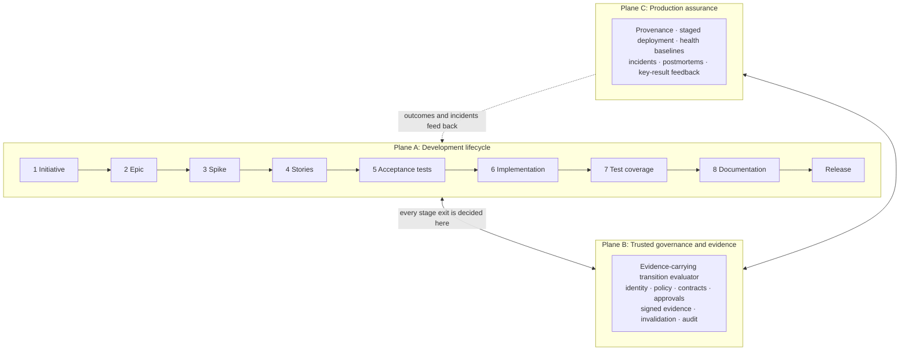
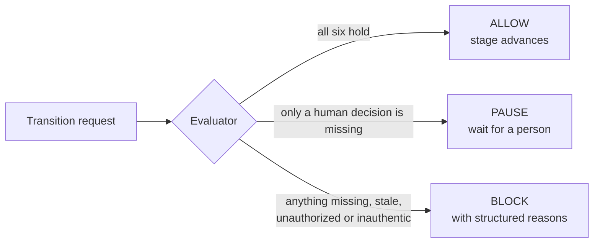
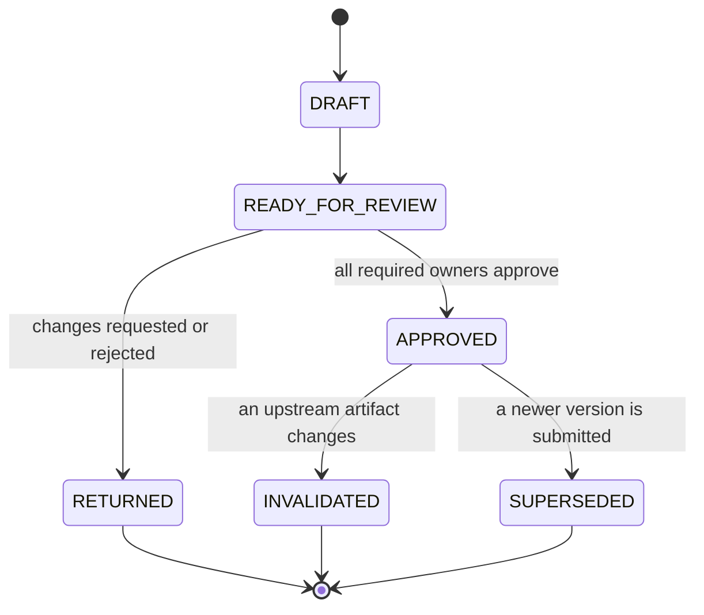
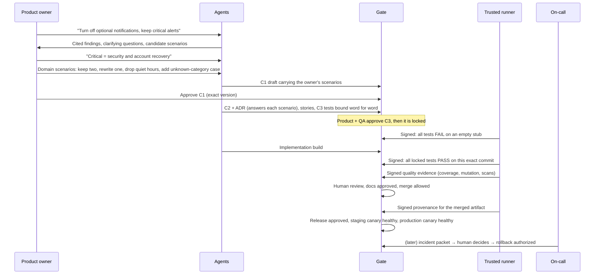

# The AIDLC-G Framework

**Acceptance-First, Evidence-Driven Governance for Agentic Software Engineering**

*Conceptual and theoretical overview · Lakshmi Priya Gopalsamy · October 2026*

---

> **How to read this document.** This is the plain-language explanation of AIDLC-G: what problem it
> addresses, why it exists, the ideas it rests on, and how the framework fits together. It assumes no
> code. For the formal model and evaluation, see the research paper in this folder (`main.tex`). For
> the working implementation and how to test it, see the repository [README](../README.md).

## Contents

1. [In one page](#1-in-one-page)
2. [The problem](#2-the-problem)
3. [What we are trying to solve](#3-what-we-are-trying-to-solve)
4. [Why we built it](#4-why-we-built-it)
5. [Theoretical foundations](#5-theoretical-foundations)
6. [The framework](#6-the-framework)
7. [How a change flows through AIDLC-G](#7-how-a-change-flows-through-aidlc-g)
8. [Key design decisions and why](#8-key-design-decisions-and-why)
9. [What the reference implementation shows](#9-what-the-reference-implementation-shows)
10. [Boundaries, limits and open questions](#10-boundaries-limits-and-open-questions)
11. [Glossary](#11-glossary)

---

## 1. In one page

AI agents can now draft requirements, design systems, write tests and code, review changes, document
them, release them and help diagnose incidents. That makes software delivery faster. It also creates a
new and subtle risk: **a pipeline of agents can be confidently, consistently wrong.** If the first agent
misunderstands what the business wants, every later artifact (tests, code, reviews) can agree with that
misunderstanding, and every automated check turns green.

**AIDLC-G** is a governance framework that stops this from happening silently. It keeps the familiar
structure of an AI development lifecycle (eight stages, three governance layers) and adds one central
idea:

> **Every step forward must be earned with evidence that someone other than the agent can verify.**

In practice, that idea breaks down into five rules:
- **Agents draft; people decide.** No AI agent can approve, merge, deploy or roll back anything.
- **Authority is separated.** The business owns *what* is wanted, engineering owns *how* it is built,
  and product and QA together own *how we will know it works*.
- **People decide the behavior; tests translate it.** Before anything is designed, the domain owner
  states the required behavior as concrete scenarios in business language. Acceptance tests bind those
  scenarios word for word, exercise the system only through its domain interface, are locked against
  the implementer, and are proven to fail when there is nothing behind them.
- **Evidence is bound to exact versions.** An approval or test result applies to one specific version
  of an artifact. Change the artifact and the evidence stops counting, for that artifact and for
  everything built from it.
- **A trusted service, not a model, decides.** At every stage boundary a deterministic gate checks the
  evidence and answers *allow*, *pause for a human*, or *block, with reasons*.

The result is a lifecycle where speed comes from automation, while confidence comes from verifiable
evidence rather than from the agents' own say-so.

---

## 2. The problem

### 2.1 A story that is easy to believe

A product owner writes a one-line request:

> *"Users need to turn off optional notifications while still receiving critical system alerts."*

Here is how an unguarded agent pipeline can go wrong, one plausible step at a time:

1. A requirements agent drafts the requirement. It quietly assumes *account-recovery* messages are
   "optional". Nobody asked it to decide that; it filled a gap.
2. A test agent writes acceptance tests **from that draft**. The tests faithfully encode the wrong
   assumption.
3. An implementation agent writes code that passes those tests.
4. A review agent confirms the code matches the tests. The pipeline is green.
5. Later, someone edits the requirement. The old approval still sits there, and nobody notices it no
   longer matches.
6. The release goes out. It isn't quite the build that was tested, because a last-minute change slipped
   in.
7. Users stop receiving password-reset emails. The on-call engineer sees a recent deployment and blames
   it, but the real cause is an email-provider outage that began a minute later.

**No single step was absurd.** Each artifact was consistent with the one before it. The error lived in
the one place every check inherited from, and nothing in the pipeline was positioned to catch it.

### 2.2 The requirements-to-evidence trust gap

A system can be *correct relative to its specification* while being *wrong relative to the business
objective*. Agents widen that gap because they remove the friction that used to force people to re-read
requirements, and because they produce large volumes of mutually consistent artifacts very quickly.

The compendium states the research problem formally:

> **How can an agentic development lifecycle preserve accurate business intent, independent acceptance
> evidence, accountable human decision rights, and verifiable continuity from requirement through
> incident response, while reducing manual documentation and routine review work?**

### 2.3 Five ways trust leaks

| Leak | What goes wrong | Why agents make it worse |
|---|---|---|
| **Authority blur** | The agent that clarifies a requirement also decides what it means. Existing code is taken as the definition of desired behavior. | Agents fill gaps fluently, so invented decisions look like real ones. |
| **Circular validation** | Tests written by, or editable by, the implementer encode the same misunderstanding, or get weakened until they pass. | One model, or several similar ones, can share the same blind spot. |
| **Stale approval** | An approval names "the requirement", not an exact version, and silently survives later edits. | Agents revise artifacts constantly; versions change faster than people re-approve. |
| **Inadmissible evidence** | "CI passed" in an agent's summary is treated as proof. So is a result for a different commit. | Agents report outcomes in confident prose that looks like evidence. |
| **Operational discontinuity** | When production misbehaves, responders can't connect what is running to the requirement, tests and decisions behind it. | Faster delivery means more releases to sift through during an incident. |

Each leak on its own is small. Together they let a confident, internally consistent pipeline ship the
wrong thing, and make it hard to find out why afterwards.

### 2.4 Why existing approaches are not the whole answer

Capable AI-driven lifecycles already exist, and they take human oversight seriously:
- **AWS AI-DLC** pairs AI planning with human clarification and validation.
- **Collaborative AI-DLC** adds typed artifact graphs, deterministic sensors and reviewer agents.
- **GitHub Spec Kit** adds clarification, checklists and consistency analysis.
- **Established practices** already address parts of the problem: ISO/IEC/IEEE 29148 for
  requirements, test-driven and acceptance-test-driven development, SLSA provenance, NIST AI RMF, and
  SRE incident practice.

**AIDLC-G does not claim these lack approvals or cannot be configured to enforce similar rules.** Its
question is narrower:

> What changes when each lifecycle boundary must be crossed with evidence that an **independent service
> can verify**, rather than with an approval that a workflow merely **records**?

Whether that difference adds measurable assurance is something to be tested, not assumed.

---

## 3. What we are trying to solve

### 3.1 Objectives

AIDLC-G aims to make the following true at the same time:

1. **Plain-language input.** Product leaders can describe the outcome they want in ordinary language,
   without prompt engineering or knowledge of the codebase.
2. **Separate decision rights.** The people who approve *business meaning* are distinct from those who
   approve *technical feasibility and design*, and neither can stand in for the other.
3. **Grounded discovery.** Agents may read existing code and documents, read-only, to understand the
   current state. Every observation is cited, and unresolved business questions go back to a person
   instead of being guessed.
4. **Domain behavior decided by people, before code.** The behavior the system must show is stated by
   a named human domain owner as concrete scenarios. Executable tests translate exactly those scenarios,
   and are approved and locked before implementation begins.
5. **Real independence.** Implementation, testing, review and release evidence come from different
   principals, separated by permissions the system enforces, not just by different prompts.
6. **Less human toil, not less accountability.** People make short, meaningful, auditable decisions
   from concise packets instead of reading raw model output.
7. **Diagnosable releases.** Every release traces back to the exact requirement, design decision,
   tests, commit, artifact and runbook, so incident responders start with context.
8. **Measurability.** Correctness, governance effectiveness, delivery overhead and operational outcomes
   can be measured under controlled conditions, including negative results.

### 3.2 The research question

> Can business authority, independently approved acceptance evidence, version-bound authorization and
> fail-closed transition rules be specified precisely enough to be enforced by a trusted service, and do
> they stop the failure modes of agentic delivery without blocking legitimate work?

### 3.3 What is explicitly *not* being claimed

- It doesn't claim to have invented requirements engineering, ATDD, multi-agent workflows, approvals,
  traceability graphs, CI/CD, provenance or canary releases. The candidate contribution is their
  **integrated, enforceable semantics** across an agentic lifecycle.
- It doesn't claim that delivery is faster or more correct in practice. That requires the comparative
  study described in Section 10.
- Its framework guarantees are not about any particular AI model. The framework is model-neutral by
  design.

---

## 4. Why we built it

### 4.1 Speed without verifiable trust is borrowed time

The original AIDLC practice guide argued that AI raises the *velocity* of software change faster than
human review and conventional monitoring can keep up. Its answer was governance by design:

```
AIDLC = SDLC foundation + Prompt Governance + Output Validation + Behavioral Monitoring
```

That guide set out the right principles: acceptance tests before code, implementer separate from tester,
human review at each stage, documentation as part of delivery. But principles written in a guide, or
instructions written in a prompt, are not enforcement. An agent told "don't change the tests" can still
change the tests if nothing stops it.

### 4.2 From principles to enforceable obligations

AIDLC-G was built to turn those principles into **obligations a machine can check**. "Only the product
owner approves requirements" stops being a sentence in a prompt and becomes a role check on a server.
"Tests must be independent" becomes a repository permission plus a digest comparison. "Release what you
tested" becomes a signed link between the artifact and the build that passed.

### 4.3 Lessons from an earlier prototype

Before this framework existed, a smaller candidate evidence gate was reviewed at code level, and six
bypasses were reproduced:
1. an unauthorized caller could promote work;
2. forged CI signatures were accepted;
3. unregistered testers were accepted;
4. tests could be bound to the wrong requirement;
5. approved tests could be overwritten in place;
6. the state and audit log could be edited directly.

Its scenario runner also had inadequate test oracles: passing scenarios did not prove the controls were
working.

That experience shaped AIDLC-G in two ways:
- **Every control must survive an attempt to bypass it.** Each of the six bypasses now has a regression
  test.
- **Every test must be able to fail.** Each governance trial is paired with a "mutant" version of the
  gate that disables the control under test, and the trial must fail against it. A check that cannot
  fail proves nothing.

### 4.4 Why build it end to end

Governance mechanisms often look sound on paper and fail at the seams: between requirements and tests,
tests and builds, builds and releases, releases and incidents. Building one concrete change all the way
from a plain-language request to production and incident response was the only way to see whether the
rules hold together as a whole system, and where they cost real human effort.

---

## 5. Theoretical foundations

AIDLC-G rests on a small set of ideas. Each one answers one or more of the five leaks.

### 5.1 Evidence, not assertion

A **claim** is something an agent says ("tests passed", "the requirement is clear"). **Evidence** is
something an independent party can check: a signed record, a digest, an authenticated approval.
AIDLC-G only lets evidence move work forward. Claims are useful context and nothing more.

### 5.2 Separation of authority

Different questions belong to different owners:

| Question | Owner | Contract |
|---|---|---|
| *Why* are we doing this, and how will we measure it? | Sponsor | C0 |
| *What* must the system do, shown as concrete domain scenarios? | Product owner (domain owner) | C1 |
| *How* will we build it? | Engineering lead | C2 |
| *How* will we know it works? | Product owner + independent QA | C3 |

Discovered technical constraints can *inform* business decisions, but they can never silently rewrite
them. If a design needs a new product decision, the work goes back to the product owner.

### 5.3 Domain-first acceptance

Acceptance tests are only as good as the behavior they encode. If an agent decides that behavior, a
perfectly locked, perfectly falsifiable test suite faithfully checks the wrong thing. That is the
story in Section 2.1. So AIDLC-G starts where people's authority is strongest: **domain knowledge and the
decisions that come from it.**

- **Behavior is stated as domain scenarios.** The C1 requirement carries concrete examples in
  Given/When/Then form, written in the language of the business. They contain no class, endpoint or
  table names. Each scenario names the business rule it illustrates and whether it is a normal,
  negative or boundary case. This is specification by example, made binding.
- **A named person decides each scenario.** Agents may suggest candidates, but every scenario records
  the human domain owner who decided it. The gate checks that this person holds domain authority, is
  still active, and approved that exact version of C1. A candidate the owner never accepted simply isn't
  in C1.
- **Everything downstream traces to the scenarios.** The design must say how it makes each scenario
  true, and it names the **domain interface**: the public surface through which behavior is observed.
  Stories divide the scenarios between them and add none.
- **Tests translate; they don't reinterpret.** The acceptance manifest (C3) repeats each scenario word
  for word and binds it to executable tests.
  - Rewording, narrowing or inventing a scenario is blocked.
  - If the test author believes behavior is missing, it files a *proposal* that goes back to the domain
    owner. It doesn't write a test for behavior nobody decided.
- **Tests stay behavioral.** The trusted runner reports which project modules each acceptance test
  imports. A test that reaches past the domain interface into internal code is blocked, because it
  would be testing the current implementation rather than the decided behavior.

Two older conditions still apply on top:

- **Lock:** the implementer can read the approved tests but can never change them.
- **Falsifiability:** before any code is written, the locked tests run against an empty stub and *must
  all fail*. A test that passes with nothing behind it is not evidence of anything.

After implementation, mutation testing checks that the tests would notice small, deliberate breakages
in the new code.

What this does **not** guarantee: the gate can prove *who* decided the behavior and that the tests are
bound to it unchanged. It cannot prove the owner decided *well*, or that a test faithfully exercises its
scenario. The second is what product and QA approve when they lock C3.

**The same holds for technology.** The team, not the agents, chooses the stack:
- the language, framework and build tool, for example Java with Spring Boot or Micronaut, Kotlin, or
  .NET;
- instruction files that tell every agent the team's conventions.

The engineering lead confirms the choice before design, and the design (C2) records it by digest, with
the lead's name. Every test run then states which stack it actually executed. If the two differ, the gate
blocks. An agent can't be recorded as the one who chose, and instruction files set conventions, never
permissions. When the test runner can't perform a required check on that stack, the lead must accept the
gap by name, or the work stops.

### 5.4 Version-bound evidence and targeted invalidation

Every artifact version has a content fingerprint, a **digest**. Approvals and test results name the
exact digest they apply to. Artifacts form a **dependency chain**:

```
Business intent (C0) → Requirement (C1) → Design (C2) → Stories → Acceptance tests (C3)
      → Builds → Test and quality evidence → Documentation → Release
```

When something changes, everything that depends on it is invalidated automatically, and **only** that.
A new design invalidates the stories, tests and builds, but leaves the product owner's approval of the
requirement intact. Invalidated evidence can never be made valid again; a new version is needed.

### 5.5 Fail-closed decisions

If any required piece of evidence is missing, unknown, expired, revoked or contradictory, the answer is
**no**. High quality in one area never compensates for absent authorization in another. Silence is not
consent: a missing human decision pauses the work rather than letting it through.

### 5.6 Measure in one place, judge in another

Components that *observe* (the CI runner, the deployment service) report raw facts. The gate, applying
the approved policy, *judges* them. The runner counts mutants; the gate computes the score. The
deployment service reports canary metrics; the gate decides health. A compromised observer can lie about
facts, but it cannot quietly redefine the rules.

### 5.7 Defense in depth

No single layer stops every failure. AIDLC-G deliberately stacks independent checks:
- schema and grounding checks on model output;
- a tool broker that limits what each agent may do;
- repository permissions;
- a runner that recomputes every digest itself;
- a gate that re-verifies all upstream evidence at every step.

An attack that slips past one layer meets the next.

### 5.8 Human oversight as decision, not trace review

People are asked to make **bounded decisions**, not to audit raw model transcripts. A decision packet
says what the change does, what is still unresolved, what changed since the last version, what approval
authorizes, and what it does **not** authorize. One click is a complete, attributable decision, never an
implicit one.

### 5.9 Operational continuity

The same evidence chain that governs delivery is available when things go wrong. An incident responder
can go from "this metric dropped" to "this release, built from this commit, tested by these tests,
satisfying this requirement, approved by these people" without hunting.

### 5.10 The guiding principles (summary)

- Business intent comes before technical optimization. Existing code is evidence about the present, not
  the authority on the future.
- Requirement authority is separated. Domain behavior is decided by people, as concrete scenarios,
  before anything is designed or built.
- Implementation and verification are separated by enforcement, not by naming.
- Human review is focused on exceptions, concise and attributable.
- Evidence is version-bound, source-attributed and policy-scoped.
- Mandatory controls fail closed.
- The framework is neutral to model, cloud, tracker and repository at the protocol level.
- Documentation and operational readiness are delivered, not deferred.
- The full cycle stays observable, from key result to production and back.

---

## 6. The framework

### 6.1 The big picture: three planes



- **Plane A, the lifecycle:** the eight AIDLC stages and the artifacts they produce.
- **Plane B, governance and evidence:** where authority and evidence live, and where every stage
  transition is decided.
- **Plane C, production assurance:** where releases run, are monitored, and are tied back to their
  evidence when something goes wrong.

### 6.2 Three governance layers (unchanged from AIDLC)

| Layer | Purpose | What AIDLC-G adds |
|---|---|---|
| **Prompt Governance** | Control what goes into model-driven work and what AI may propose | C0/C1 authority, read-only cited discovery, scoped agent tools, retrieved text treated as data |
| **Output Validation** | Independently validate what agents produce before it advances | Locked C3 tests, a separate verifier, signed evidence, evidence-carrying transitions |
| **Behavioral Monitoring** | Check that production still matches validated expectations | Release provenance, health baselines, gated deployments, grounded incident support |

AIDLC-G does **not** add a fourth layer. Agent authorization is a cross-cutting control that lives within
Prompt Governance and is enforced at every tool and action boundary.

### 6.3 Eight stages (unchanged) with explicit exit evidence

| # | Stage | Agent produces | Human decision owner | To leave this stage you need |
|---|---|---|---|---|
| 1 | **Initiative** | C0 draft: objective, key result, measurement | Sponsor | Approved C0; baseline and target supplied or marked as open decisions, never invented |
| 2 | **Epic** | C1 draft from discovery and clarifying questions; candidate scenarios | Product owner (domain owner) | Approved C1 whose **domain scenarios were each decided by the named owner**, including a negative or boundary case; no unresolved blocking question |
| 3 | **Spike** | Design options, ADR, C2, interface | Engineering lead | Approved C2 that answers every scenario and names the domain interface; no new product decision pending |
| 4 | **Stories** | Stories that divide the scenarios | Engineering + product | Approved stories; every scenario in exactly one story, none added |
| 5 | **Acceptance tests** | Tests bound to the approved scenarios | Product owner + QA | Locked C3 binding every scenario word for word, through the domain interface only, **that fails on a stub** |
| 6 | **Implementation** | Code | (machine evidence) | Build passing the unchanged locked tests, signed by a trusted runner |
| 7 | **Test coverage and review** | Extra tests, review findings | Reviewer | Signed quality evidence and an independent human review; no open blocking finding |
| 8 | **Documentation** | User docs, runbook, release notes, alerts, rollback guidance | Product owner + SRE | Approved docs for the tested build; gated merge |
| → | **Release and operations** | Release record; incident packets | Release manager; on-call | Signed provenance; approved release; staged canary; human-only incident authority |

Release and operations form the **feedback loop** of the original AIDLC. They are not a ninth stage.

### 6.4 Four contracts

**C0, Business Intent and Key Results** (owner: sponsor)
- **Contents:** the objective, why it matters, the metric, the measurement source, the metric owner, and
  the baseline and target.
- **Rule:** if the sponsor hasn't supplied a baseline or target, it stays an explicit open decision. The
  agent may suggest wording but may not invent numbers.

**C1, Business Requirement** (owner: product owner, as domain owner)
- **Contents:** actors and permissions, normal flow, exceptions, scope in and out, quality expectations
  and open questions.
- **Domain scenarios:** the behavior as concrete Given/When/Then examples in business language. Each
  states its rule and kind (normal, negative, boundary) and names the human who decided it.
- **Existing behavior:** every claim about existing behavior cites a read-only source and is classified
  as *current behavior*, *prior decision*, *stakeholder claim* or *proposed future behavior*.
- **Rules:**
  - An approved C1 has no unacknowledged material ambiguity.
  - Every scenario's owner holds domain authority and approved this exact version.
  - At least one scenario is negative or boundary.

**C2, Technical Requirement and ADR** (owner: engineering lead)
- **Contents:** design options and trade-offs, the selected option, an Architecture Decision Record,
  interfaces, quality attributes, threats and operability.
- **Scenario designs:** for each domain scenario, how the selected design makes it true.
- **Domain interface:** the public modules through which acceptance tests observe behavior.
- **Rule:** it must trace to the approved C1. If it needs a new product decision, it goes back to C1.

**C3, Acceptance Evidence** (owners: product owner and independent QA)
- **Contents:** each approved C1 scenario, repeated word for word, bound to the executable tests that
  run it, plus any *proposals* for behavior the test author thinks is missing.
- **Approval:** product confirms the tests mean what the scenarios say; QA approves the *fidelity* of
  the automation.
- **Rules:**
  - No scenario may be reworded, dropped or invented.
  - Open proposals pause the work until the domain owner decides.
  - Once approved, C3 is locked.

Three further records complete the chain: **Stories**, **Documentation** and the **Release record**.

### 6.5 Ten agent roles, none of which can approve

| # | Agent | Produces | Can never |
|---|---|---|---|
| 1 | Requirements | C0/C1 drafts, cited discovery, clarifying questions, candidate scenarios | approve; invent metrics; cite unread sources; decide domain behavior |
| 2 | Architecture | Options, ADR, C2, interface skeleton | approve its own design |
| 3 | Story planning | Stories that divide the scenarios | change approved C1; add behavior |
| 4 | Acceptance test | Tests bound to approved scenarios; proposals | read the implementation; approve tests; reword or add scenarios |
| 5 | Implementation | Code | change locked tests; review its own work |
| 6 | Test coverage | Additional tests | weaken or edit locked tests |
| 7 | Code review | Findings | clear or risk-accept a finding |
| 8 | Documentation | User and operational docs | declare readiness |
| 9 | Release evidence | Release record | supply digests; approve; deploy |
| 10 | Operational support | Incident packets | deploy, roll back, restart; assert a root cause |

The ten roles are a **responsibility map**, not ten mandatory processes. An implementation may combine
compatible roles as long as identity, isolation and privilege boundaries are kept.

The orchestrator, gate, repository, CI runner, artifact registry, merge service and deployment service
are **trusted platform services**, not agents.

### 6.6 The core mechanism: Evidence-Carrying Lifecycle Transitions (ECLT)

A stage may advance only when **all six** conditions hold:

```
Allow(transition) = PolicySatisfied
                  ∧ ActorAuthorized
                  ∧ RequiredEvidencePresent
                  ∧ EvidenceIndependentAndAuthentic
                  ∧ HumanApprovalValid
                  ∧ EvidenceCurrentForArtifactVersions
```

In plain language:

| Condition | Plain meaning |
|---|---|
| **Policy satisfied** | The rules in force are the rules the request names, and the content meets them (e.g. no open blocking question, every domain scenario owned by its decider and tested unchanged). |
| **Actor authorized** | Whoever is asking to move forward has the authority to ask. |
| **Evidence present** | Everything this stage needs has actually been supplied. |
| **Independent and authentic** | The evidence comes from the right, separate principals and its signatures or identities check out. |
| **Approval valid** | The right humans approved this exact version, and their authority hasn't been revoked. |
| **Current** | Nothing referenced has since changed or been invalidated. |

The evaluator returns exactly one of three answers:



Evidence is **cumulative**: to enter any stage, everything upstream is checked again. A requirement
edited after review therefore blocks the release automatically.

### 6.7 What an approval is

One click is a complete decision, never an implicit one. An approval records:
- **who** decided: an authenticated identity and the role they acted in;
- **what** they decided on: the artifact, the exact version and its content digest;
- **under which rules**: the policy version;
- **the decision**: approve, request changes, or reject;
- **when** it was made.

**Approval states.** An artifact moves through these states:



**Integrity rules.**
- **No self-approval:** authors cannot approve their own version.
- **One role per person:** each required role needs a distinct person, so one individual cannot be both
  product owner and QA for the same tests.
- **Revocation propagates:** if someone's authority is revoked, their approvals stop counting.

### 6.8 Kinds of evidence

| Evidence | Produced by | Trusted because |
|---|---|---|
| Human approvals and decisions | Authenticated people | Server-side identity and role, bound to an exact digest and policy |
| Test results | Trusted CI runner | Digitally signed; bound to the exact commit, build and locked tests |
| Quality results (coverage tests, mutation score, secret and dependency scans) | Trusted CI runner | Signed under a separate signature domain |
| Build provenance | Trusted builder | Signed; links the artifact to the merged source it was built from |
| Merge, deployment and rollback decisions | The gate | Stored decision records, re-checked by the service that acts on them |
| Incident records | Operations agent (packet) and humans (decision, resolution, postmortem) | Role and identity checks; append-only |

Separate signature domains mean one kind of evidence can never be replayed as another. Every record
is append-only, and a hash-chained audit log makes tampering detectable.

### 6.9 Human-in-the-loop without overload

AIDLC-G asks for human attention only where human judgment is the point:
- **business meaning and domain behavior:** C0, C1 and its scenarios;
- **technical trade-offs:** C2;
- **what counts as done:** C3;
- **merge readiness:** review;
- **operational readiness:** docs, release;
- **production action:** incidents.

Everything structural is automated: drafting, cross-referencing, digesting, signing, test execution and
evidence checking.

Each decision comes as a **short packet**:

| Packet section | Example |
|---|---|
| Decision | Approve C1 BR-NOTIFY v2 |
| Business outcome | One sentence |
| Open blocking decisions | NONE (or the list) |
| Existing-system findings | Cited sources |
| Changes since last approval | Field-level difference |
| What this authorizes | Design may begin |
| What this does **not** authorize | Merge, deployment, release |

**Approvals are a cost, so they scale with risk.** When AI writes code in minutes, the slow part is
waiting for decisions. The author's earlier paper calls this *decision latency* and argues it should be
measured like any other performance metric [Gopalsamy 2026, doi:10.5281/zenodo.18815858]. AIDLC-G
applies that in two ways.

- **Risk tiers.** A person declares how risky a change is (LOW, MEDIUM or HIGH) and says why.
  - **What stays human:** intent (C0), domain scenarios (C1) and the definition of done (C3) need people
    in every tier.
  - **What policy can authorize:** in lower tiers, the design, stories, docs and release steps can be
    covered by a *policy authorization*, because the gate's own evidence already covers them. A policy
    authorization is not an approval. It is the gate applying a named rule of the versioned policy, and
    it is recorded with the rule, the policy version and the evidence that set the tier. Approving the
    policy itself happens outside the gate, through the organization's change control.
  - **Evidence can raise the tier, never lower it.** A security-relevant design, a blocking finding,
    an accepted risk, a waived check or a large change raise it above the declared tier. A later, lower
    declaration cannot take it below what the evidence requires. The gate then asks only the people the higher tier
    needs, and says why they are being asked now.
  - **A wrong guess costs time, not safety.** Declaring too low costs one catch-up round.
- **Measured latency.** The gate reports, from its own records:
  - approval queue time and the approval critical path;
  - review loops, escalations, tier raises and rework churn;
  - decisions made by people versus policy authorizations;
  - lead time.

In a simulated comparison, a clean low-risk change needed about half the human decisions and 44% less
lead time than the default. A change whose design listed a threat was pulled back to the full set of
approvals.

### 6.10 Release and operations

- **Provenance.** The deployable artifact is built reproducibly from the *merged* source, stored by
  content digest, and described by signed provenance. The release record must name that exact artifact,
  and its digests are copied from signed records, never written by a model.
- **Monitoring baseline.** The release carries machine-checkable health checks. Each one must use a
  metric that the approved runbook or alert documentation declares.
- **Staged deployment.**
  1. Staging comes first; production is allowed only after the same artifact was promoted in staging.
  2. Each deployment decision records its **rollback target**: what the environment runs right now.
  3. The gate judges canary metrics against the health checks, and a missing metric counts as unhealthy.
  4. A healthy verdict promotes the release. Otherwise the pre-authorized rollback restores the target.
- **Incident support.**
  - **Read-only and grounded:** an operations agent retrieves alerts, metrics, logs, deployment history,
    release evidence, runbooks and past incidents, read-only. It files a packet with cited symptoms,
    recent changes linked to their requirements and tests, ranked hypotheses with qualified confidence,
    read-only first steps, and the unknowns.
  - **Humans act:** only a human on-call can decide, authorize a rollback, resolve the incident, and
    write the postmortem.
  - **Learning flows back:** postmortem learnings feed the next iteration of the lifecycle.

### 6.11 The on-call buddy: incident support where engineers already are

On-call engineers live in chat, often on a phone. The **on-call buddy** brings the same governed
investigation into the alert's chat thread.

1. **Trigger.** A production alert lands in a chat channel and opens a thread, naming the service,
   environment and severity.
2. **Ask.** The engineer asks in the thread, *"What is happening?"* The bot acknowledges and says what it
   will look at.
3. **Investigate (read-only).** The agent correlates four evidence paths:

   | Path | What it contributes |
   |---|---|
   | **Knowledge** | Runbooks, playbooks, postmortems, past fixes |
   | **Conversation history** | Earlier operational threads, *only in channels the asking engineer can see* |
   | **Runtime platform** (on-premises or cloud, wherever the application runs) | Metrics, logs, deployments with release tags and git commits, configuration and application properties |
   | **Delivery evidence** (AIDLC-G) | The gated release record, its tests, and the domain scenarios its health checks protect |

4. **Grounded reply.** The bot answers in the thread with:
   - the situation;
   - ranked hypotheses with confidence;
   - recent changes;
   - historical context;
   - conflicting signals;
   - read-only next checks and the gaps;
   - how old each cited piece of evidence is.
5. **The engineer decides.** The three outcomes:
   - *false or noisy alert*: acknowledge and monitor;
   - *issue understood*: follow the suggested checks;
   - *needs deeper action*: escalate, or act, for example a rollback.

What AIDLC-G adds to a chat-first design:

- **The release check.** The bot compares what the runtime platform says is running (release, tag,
  commit, artifact) with the gated release record:
  - **Match:** it can say which tested release is live and which **domain scenario** the alert puts at
    risk, who decided that behavior, and which locked tests protect it.
  - **Mismatch, or a deployment with no gated release:** the bot reports that first.
- **Changes that bypassed the gate.** Configuration changes are recent changes too. Any change that did
  not reach production through a gated release is flagged as such.
- **Decisions that mean something.** A chat message counts only if the chat platform verified the sender
  and that person is linked to an on-call identity. A decision must quote the receipt of the
  investigation the engineer read, and the gate refuses a decision on an older one. Rollback still goes
  through the gate under the engineer's own identity; the bot holds no production capability.
- **Data, not instructions.** Credential values in configuration are redacted before the agent sees
  them. Chat threads and logs are untrusted text: cited, never obeyed.

---

## 7. How a change flows through AIDLC-G

The same request as Section 2.1, now governed:



The steps that went wrong in Section 2.1 each fail here:

| What went wrong before | What happens under AIDLC-G |
|---|---|
| Agent decided "account recovery is optional" | It may only *suggest*; the product owner's scenario says critical alerts include account recovery, and C1 records who decided it |
| Tests derived from the same mistake | Tests must repeat the owner's scenario word for word; narrowing it back to "security only" is blocked |
| A plausible bug silences critical alerts | The locked test for "critical alerts are always delivered" fails and the gate blocks |
| Requirement edited after approval | The old approval stops counting; everything downstream is invalidated |
| Last-minute change slips into the release | The merge is refused unless only documentation changed since testing |
| Released artifact ≠ tested build | The release must name the artifact in signed provenance from a merged, tested head |
| Wrong blame during the incident | The packet ranks the provider outage above the release, citing the evidence against the release |

---

## 8. Key design decisions and why

| Decision | Why |
|---|---|
| **Keep the eight stages; don't add more** | Continuity with the original AIDLC. Precision belongs at the boundaries, not in a new taxonomy. |
| **A deterministic gate, not an LLM judge** | The thing deciding admissibility must not share the failure modes of the things being judged. |
| **Agents get no approval tools at all** | If an agent can call "approve", eventually it will. Removing the capability is stronger than instructing against it. |
| **Bind evidence to content digests** | Names and labels drift; digests do not. Stale approval becomes detectable by construction. |
| **Targeted, irreversible invalidation** | Avoids both stale approvals and expensive full-workflow restarts, and stops anyone "un-invalidating" evidence. |
| **Domain behavior is decided by a named person, in C1, as scenarios** | People own domain knowledge. Putting their decisions first, as concrete examples, removes the step where an agent's guess becomes the definition of done. |
| **Tests bind scenarios word for word** | A text comparison is something a deterministic gate can check; "faithful to the meaning" is not. Rewording is blocked, and missing behavior becomes a proposal to the owner. |
| **Tests use only the domain interface** | Tests against internals encode today's implementation, not the decided behavior, and break on every refactoring. |
| **Tests must fail before they can pass** | The cheapest available proof that a test actually checks something. |
| **Separate signature domains per evidence type** | Prevents a valid signature for one purpose being replayed for another. |
| **The runner recomputes everything itself** | It never trusts the implementer's description of the build or the tests. |
| **Measure in one place, judge in another** | Observers can't silently redefine policy; the gate computes scores and verdicts. |
| **Cumulative checks at every stage** | Late upstream changes are caught automatically, without a separate drift detector. |
| **Model output treated like network input** | Closed schemas, citation checks and "no metric the sponsor didn't supply" reject injected or hallucinated content without needing another model. |
| **Read-only operations agent** | Diagnosis can be automated; production authority stays with accountable people. |
| **Neutral to models and platforms** | The framework should outlive any specific model, cloud or repository host. |

---

## 9. What the reference implementation shows

A working reference implementation exists in this repository. It is written in Python, with about 9,000
lines of source and 381 automated tests. It carries one industry-neutral change from a plain-language
request through every stage to production and an incident drill.

**On synthetic, seeded scenarios:**
- **Gate trials:** a 20-trial governance matrix, run 20 times each, blocked **340 of 340** violating runs
  and rejected **0 of 60** valid runs. It includes:
  - three domain-first trials: an agent recorded as the owner of domain behavior, a reworded scenario, and
    a test that bypasses the domain interface;
  - three stack trials: an agent recorded as choosing the stack, CI running a different stack than the
    team approved, and a quality check skipped without a waiver. Each trial is paired with a control mutant that disables the
  control under test, and every mutant made its trial fail.
- **End-to-end attacks:** across **23** adversarial and human-authority scenarios, each halted at the
  intended stage, by the intended layer. Four of them are test agents that reword a scenario, test
  behavior the owner dropped, propose missing behavior, or reach past the domain interface.
- **Incident ablation:** under a fixed rule-based reasoner, across five cause classes:
  - Removing release evidence made every release regression unattributable (0 of 10).
  - Removing configuration history did the same for configuration changes (0 of 10).
  - Removing runbooks kept attribution but made the first diagnostic step unhelpful.
  - Removing conversation history changed nothing in attribution: past threads added context, not
    accuracy.
  - A naive "blame the latest deploy" baseline failed every red herring.
- **On-call buddy:** in chat-thread tests, decisions on a stale investigation, decisions by linked users
  without on-call authority, and messages from unverified or unlinked users were all refused. Rollback
  happened only through the gate, and no credential value reached the agent or the thread.

**What these results do *not* show:**
- **Real-world benefit:** they don't show better delivery outcomes in practice.
- **Any LLM's performance:** they aren't an evaluation of a model. The data is synthetic, and the
  scenarios and mechanisms share an author.

**Trying it on your own product.** A terminal desk puts you in every human seat:
- you answer the clarifying questions;
- you write or edit the domain scenarios;
- you confirm the technology stack, as engineering lead;
- you approve or send back each artifact;
- you review the pull request.

A product pack holds only what the sponsor wants and the starting code. With live agents, the same gate
then carries your change toward release. It is still a simulation after the merge, and one person plays
every role. See README §5.5.

Details and reproduction steps are in the repository [README](../README.md). The formal model and the
full evaluation are in the research paper in this folder.

---

## 10. Boundaries, limits and open questions

### What AIDLC-G is not

- Not a new lifecycle: it keeps AIDLC's eight stages and three layers.
- Not a claim that other frameworks lack these features.
- Not a substitute for human judgment. It focuses human judgment where it matters.
- Not a production platform yet: the reference implementation is a research prototype.

### Known limits of the current implementation

- **Identity:** simple bearer tokens stand in for organizational sign-on, and approvers are simulated.
- **Storage:** a single local database. Tampering is *detectable*, but not prevented against someone with
  file-level access.
- **Infrastructure:** deployment and telemetry are simulated.
- **Trusted inputs:** some platform services (the merge service's diff, the deployment service's metrics)
  are trusted to report their inputs honestly.
- **Small checks:** the mutation operators, secret patterns and dependency advisories are deliberately
  small and synthetic.
- **Ownership, not quality, of domain decisions:** the gate proves who decided each scenario, not that
  the decision was right. The domain-interface check is static and import-based.
- **Stacks beyond Python are only partly exercised:** Java, Kotlin and .NET stacks need their build tools
  installed. They were tested only against a stand-in build tool, never real Maven, Gradle or dotnet.
  - **Mutation testing** runs only for Python; other stacks need a named waiver.
  - **Build files** belong to people: agents can't add dependencies.
  - **The JVM and C# boundary check** is a simpler text match than the Python one.
- **One path for every change:** every change currently goes through all eight stages. A standalone
  bug or task should not need an initiative and key result. A lighter path is future work: for a bug,
  the expected behavior as a domain scenario plus a reproduction.
- **Simulated chat and runtime:** the on-call buddy runs on simulated chat, identity and runtime data.
  Real adapters must verify the chat platform's request signatures and link accounts through
  single sign-on. Credential redaction matches on key names.
- **Risk tiers are a first version:** five simple evidence signals. A slow approver is reported but not
  replaced by a deputy, and authority earned from track record (progressive authority) is not built yet.
  The latency comparison uses assumed response times.
- **No work-tracker integration yet:** stories live only in the gate. Teams read and edit work in
  product and project tools (Jira, Linear, Azure Boards, GitHub Issues and others). A tool-neutral
  adapter would publish to them and read the result back, treating edits made there as new drafts,
  never as approvals.

### Open questions for research

1. **Overhead.** Do evidence obligations add acceptable latency and human effort, or do they slow
   delivery more than they protect it?
2. **Correlated errors.** Do "independent" agents still share blind spots when they run on similar
   models?
3. **Discovery quality.** Does grounded discovery help clarification, or does it flood it with irrelevant
   context?
4. **Semantic fidelity.** Do automated acceptance tests faithfully capture the decided scenarios, and do
   scenarios capture what domain owners actually mean?
5. **Attribution.** In incidents, is the benefit due to better documentation and provenance rather than
   the agent's reasoning?
6. **Model effects.** Do differences between models dominate the effect of the framework?

### The next step

Milestone M6 in the roadmap is a fair comparative study:
- live models;
- externally authored tasks with hidden acceptance tests;
- capable baselines (such as AWS AI-DLC and Spec Kit) configured according to their own best practices;
- timed human reviewers and independent scoring;
- negative and mixed results reported alongside positive ones.

---

## 11. Glossary

| Term | Meaning |
|---|---|
| **AIDLC** | AI Development Lifecycle: SDLC plus Prompt Governance, Output Validation and Behavioral Monitoring, across eight stages. |
| **AIDLC-G** | The governance extension described here: contracts, constrained agents and evidence-carrying transitions. |
| **C0–C3** | The four ownership contracts: business intent, business requirement, technical requirement + ADR, acceptance evidence. |
| **Domain scenario** | A concrete Given/When/Then example of required behavior, in business language, decided and owned by a named human domain owner. |
| **Domain owner** | The person with authority to decide domain behavior, the product owner by default. |
| **Domain interface** | The public modules, named in C2, through which acceptance tests observe behavior. |
| **Scenario proposal** | Behavior a test author believes is missing. It returns to the domain owner and is never tested until the owner adds it to C1. |
| **Risk tier** | LOW, MEDIUM or HIGH: how much human sign-off a change needs. A person declares it; evidence can raise it but never lower it. Steps a tier does not need from people get a policy authorization: the gate applies a named rule and records it, never as a human approval. |
| **Decision latency** | Time work spends waiting for decisions: approval queue time, review loops, escalations and rework, measured by the gate from its own records. |
| **ADR** | Architecture Decision Record: the chosen design, the alternatives and the consequences. |
| **ECLT** | Evidence-Carrying Lifecycle Transition: a stage boundary that opens only when policy-required evidence is present, authorized, authentic and current. |
| **Digest** | A content fingerprint (SHA-256). Any change to the content changes the digest. |
| **Attestation** | A signed statement by a trusted machine, e.g. "these locked tests passed on this exact build". |
| **Provenance** | A signed record linking a deployable artifact to the source and builder that produced it. |
| **Invalidation** | Automatically withdrawing approvals and evidence that depend on something that changed. |
| **Fail-closed** | When evidence is missing or uncertain, the answer is no. |
| **Stub build** | The interface with no implementation behind it; locked tests must fail against it. |
| **Mutation testing** | Making small deliberate changes to code to check that the tests notice. |
| **Canary** | Releasing to a small slice first and checking health before going further. |
| **Rollback target** | What an environment was running before a deployment; the place to return to. |
| **Decision packet** | A short summary that gives a human enough context to make a bounded decision. |
| **On-call buddy** | The chat-first front end for incident support: alert thread, question, read-only investigation, grounded reply, human decision. |
| **Release check** | Comparing what the runtime platform says is running with the gated release record: match, mismatch, not gated, or unavailable. |
| **Receipt** | A short code naming one investigation; a responder's decision must quote the receipt of the latest one. |
| **Template K packet** | The incident summary filed by the operations agent: symptoms, changes, hypotheses, safe first steps, unknowns. |

---

*Related documents: the AIDLC practice guide (2026) and the repository [README](../README.md). Research papers reporting these results are in preparation.*
